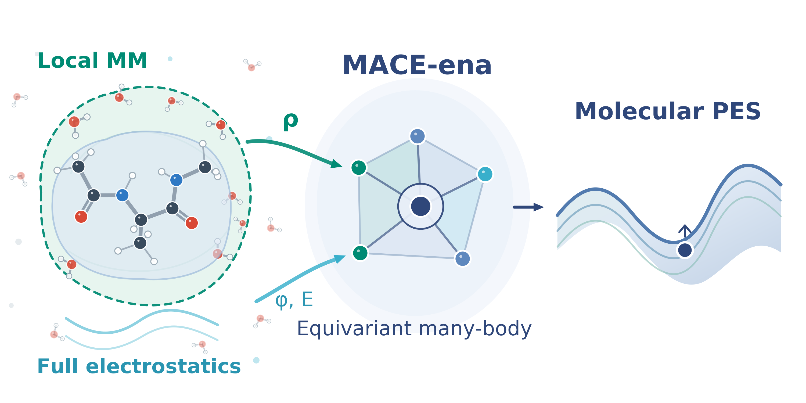
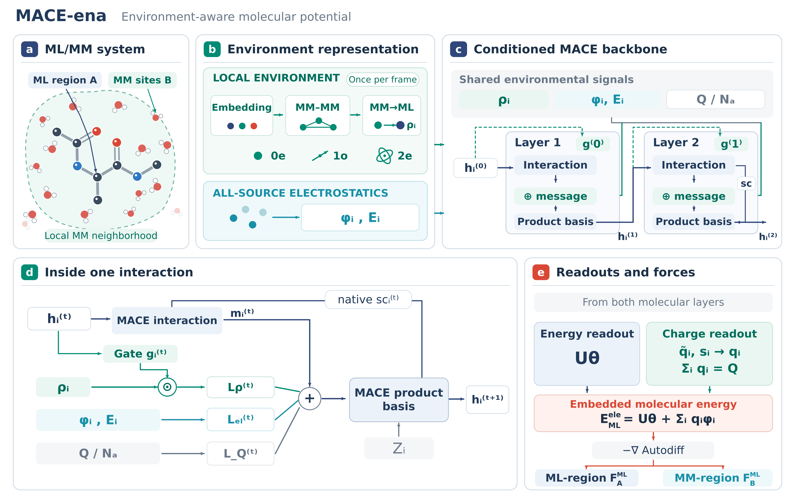

# MACE-ena

> 🚧 **Under construction.** Code and documentation are under active development.

[](LICENSE.md)
[](https://www.python.org/downloads/)
[](https://doi.org/10.5281/zenodo.23808671)

<p align="center">
  
</p>

**MACE-environment-aware (MACE-ena)** is an equivariant framework for learning molecular potential-energy surfaces in chemical environments. It incorporates the elements, charges and spatial arrangement of nearby molecular mechanics (MM) atoms into molecular many-body representations, together with electrostatic potentials and fields from the full MM environment. The model couples molecular energies to environment-dependent atomic charges and obtains forces on both regions from a shared energy expression.

- **Environment-aware representations:** local MM chemistry and full-environment electrostatics enter the molecular interaction layers.
- **Efficient evaluation:** shared environment encoding, batched inference and GPU acceleration with cuEquivariance and Triton.
- **Molecular modeling:** ASE calculations and periodic machine learning/molecular mechanics (ML/MM) simulations in OpenMM.

[Architecture](#architecture) · [Installation](#installation) · [Quick start](#quick-start) · [Training](#training) · [ML/MM simulations](#mlmm-simulations) · [Models](#models) · [Citation](#citation) · [Upstream MACE](#upstream-mace-and-modifications) · [License](#license)

## Architecture

<p align="center">
  <a href="mace/modules/envhead/Fig1.png"></a>
</p>

The local MM environment is encoded once per configuration and shared across the molecular interaction layers. These features, the electrostatic potential and field, and the molecular total charge condition the MACE representation. Energy and charge readouts produce the embedded molecular energy, with charge redistribution enforcing the molecular total charge. Forces follow by differentiation of this energy.

## Installation

Install Python 3.10 or later and [PyTorch](https://pytorch.org/get-started/locally/) for your hardware, then install from the repository root:

```bash
python -m pip install -e .
```

For CUDA 12 acceleration and cuEquivariance-enabled models:

```bash
python -m pip install -e '.[cueq,cueq-cuda-12]'
```

Enable it with `--enable-cueq` for training or `enable_cueq=True` in the ASE calculator. Fused electrostatic kernels are selected automatically for supported CUDA calculations when Triton is installed.

## Quick start

Use a trained MACE-ena model with an embedded molecular configuration:

```python
from ase.io import read
from mace.modules.envhead.calculator import EnvHeadCalculator

atoms = read("configuration.extxyz")
atoms.calc = EnvHeadCalculator("model.model", device="cuda")

energy = atoms.get_potential_energy()
forces = atoms.get_forces()
mm_forces = atoms.calc.get_mm_forces(atoms)
```

The ASE `Atoms` object contains the molecular region. Its `info` dictionary supplies `mm_positions`, `mm_charges`, `mm_atomic_numbers` and the molecular `total_charge`. Coordinates are in Å, energies in eV and forces in eV/Å. The calculator returns the embedded molecular energy and its force contributions on both regions. Set `device="cpu"` for CPU calculations.

A runnable [water-in-water example](mace/modules/envhead/example/single_point.py) includes the molecular geometry and three MM sites. From the repository root:

```bash
python mace/modules/envhead/example/single_point.py model.model --output prediction.npz
```

The script runs on CPU by default. Add `--device cuda` for GPU execution or `--structure your.extxyz` for your own configuration. It prints the energy and both force arrays, and `--output` saves them in NumPy format. MM coordinate arrays use ASE's `_JSON` encoding in extended XYZ and are restored automatically by `ase.io.read`.

Evaluate a labeled dataset with:

```bash
python -m mace.modules.envhead.script.evaluate \
  --checkpoint model.model \
  --data test.extxyz \
  --output evaluation \
  --device cuda
```

## Training

Training uses molecular structures and their MM environments in extended XYZ or native MACE HDF5 format:

| Field | Content |
|---|---|
| `REF_energy`, `REF_forces` | Reference embedded molecular energy and molecular forces |
| `mm_positions`, `mm_charges`, `mm_atomic_numbers` | MM coordinates, charges and atomic numbers |
| `total_charge` | Molecular total charge |

The included [model configuration](mace/modules/envhead/example/envhead.json) uses shared local environment encoding, full-environment electrostatics and Fukui-style charge redistribution. Edit `near_radius` to select the local MM radius in Å.

Initialize from a MACE model and train on embedded reference data:

```bash
python -m mace.modules.envhead.train \
  --name mace_ena \
  --foundation /path/to/mace.model \
  --head-config mace/modules/envhead/example/envhead.json \
  --train-file train.extxyz \
  --valid-file valid.extxyz \
  --work-dir runs/mace_ena \
  --charges-weight 0 \
  --device cuda
```

The local MM radius is specified in Å. Reference MM forces can be included with `--mm-forces-weight`. Training exports complete `.model` files for inference and checkpoints for continuation. Run `python -m mace.modules.envhead.train --help` for training controls.

## ML/MM simulations

The OpenMM interface supports electrostatic embedding (`mlmm-em`) and mechanical embedding (`mlmm-mm`), NVE/NVT/NPT dynamics, checkpoint continuation and PLUMED enhanced sampling.

For CUDA 12, install the additional simulation dependencies from the repository root:

```bash
python -m pip install -r mace/modules/envhead/script/mlmm/requirements.txt
```

Generate a configuration, set the model, input structure and ML atom indices, and run:

```bash
python -m mace.modules.envhead.script.mlmm --initial
# Edit md.json for your system.
python -m mace.modules.envhead.script.mlmm --config md.json
```

See the [ML/MM guide](mace/modules/envhead/script/mlmm/README.md) for system preparation, optional dependencies and enhanced sampling.

## Models

Trained models: [Zenodo](https://doi.org/10.5281/zenodo.23808671).

## Citation

If you use MACE-ena in your research, please cite:

```bibtex
@unpublished{zhou_mace_ena,
  author = {Zhou, Xuchao and Wang, Yiming and Liu, Jinfeng},
  title = {Learning Environment-Aware Molecular Representations for Multiscale Modeling},
  note = {Manuscript}
}
```

Please also cite the underlying [MACE architecture](https://proceedings.neurips.cc/paper_files/paper/2022/hash/4a36c3c51af11ed9f34615b81edb5bbc-Abstract-Conference.html):

```bibtex
@inproceedings{batatia2022mace,
  author = {Batatia, Ilyes and Kov{\'a}cs, D{\'a}vid P{\'e}ter and Simm, Gregor N. C. and Ortner, Christoph and Cs{\'a}nyi, G{\'a}bor},
  title = {{MACE}: Higher Order Equivariant Message Passing Neural Networks for Fast and Accurate Force Fields},
  booktitle = {Advances in Neural Information Processing Systems},
  volume = {35},
  pages = {11423--11436},
  year = {2022},
  doi = {10.52202/068431-0830},
  url = {https://proceedings.neurips.cc/paper_files/paper/2022/hash/4a36c3c51af11ed9f34615b81edb5bbc-Abstract-Conference.html}
}
```

## Contributing and contact

Bug reports, questions and feature requests are welcome through [GitHub Issues](https://github.com/AmiHaruka/mace-ena/issues). Contributions can be submitted as pull requests.

## Acknowledgments

MACE-ena builds on [MACE](https://github.com/ACEsuit/mace) and uses [e3nn](https://github.com/e3nn/e3nn), [PyTorch](https://pytorch.org/) and [ASE](https://gitlab.com/ase/ase). GPU acceleration uses [cuEquivariance](https://github.com/NVIDIA/cuEquivariance) and [Triton](https://github.com/triton-lang/triton).

## Upstream MACE and modifications

This repository extends [MACE](https://github.com/ACEsuit/mace) from the following base:

| Item | Identifier |
|---|---|
| Base MACE version | `0.3.17` |
| Upstream branch | `develop` |
| Base commit | [`59ad3a473ca02101a1cf02db242197e8d616dd11`](https://github.com/ACEsuit/mace/commit/59ad3a473ca02101a1cf02db242197e8d616dd11) |
| MACE-ena branch | `feat/ena` |

Changes relative to this base:

| Location | Changes |
|---|---|
| [`mace/modules/envhead/`](mace/modules/envhead/) | Environment encoding, electrostatic charge coupling, batched evaluation, training, ASE and OpenMM interfaces, and GPU kernels |
| [`mace/data/neighborhood.py`](mace/data/neighborhood.py) | Translated search coordinates for fully nonperiodic neighbor lists |
| [`mace/modules/models.py`](mace/modules/models.py), [`mace/modules/extensions.py`](mace/modules/extensions.py) | Additional `interaction_energy` outputs for MACE and MACELES |
| [`setup.cfg`](setup.cfg) | The `mace_env_train` command and optional `neighbors` dependencies |
| [`.gitignore`](.gitignore) | Exclusions for local research assets and generated files |

## License

Released under the [MIT license](LICENSE.md). The upstream MACE copyright and license notices are retained.
