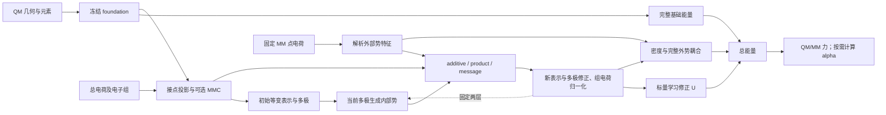

# EnvHead direct delta：架构与物理合同

2026-09-12。本文描述本目录新版实现；此前双重变分最小化架构及其图片是历史方案。
新版不加载旧权重。当前验收见 [validation](docs/validation.md)，不等同于真实 QM 精度或 MD 稳定性验证。

## 计算图

## 表示与更新

默认隐藏通道 `32x0e+32x1o+32x2e`，correlation=2，固定两层、独立权重。
`p=(q,mu,Theta)` 是具有明确 Gaussian 基与单位的密度系数；多通道 `z` 承担额外化学
表示。每层按 `p → internal field → z_new → p_new` 同步更新全部原子。最后一次更新
后重算内部势供读出，不把旧内部势与新多极混用。

| fusion | 机制 |
|---|---|
| additive | 五路等变投影相加，进入 MACE interaction/product |
| product | 再加入几何×内外势、多极×内外势的合法张量积 |
| message | 两端融合表示和方向构造消息；两端标量与径向特征控制消息权重，聚合后 product |

三者都保留残差与多体表示。普通 MLP 只处理旋转不变量。MMC 默认关闭，开启时仅用 QM
几何生成接点缺失的初始阶数；不补造物理标签。初始多极/修正读出为零，经电荷分配后
每组初始电荷均分、偶极与四极为零。Fukui-like softmax 权重每层重分配组总电荷偏差；
它保证守恒，不宣称等于严格的电荷态导数。没有状态最小化或静默截断最终多极。

message 的标量边系数使用 tanh，消息乘平滑 cutoff，并按接收原子的
`1 + sum(cutoff)` 归一化。MMC 的几何聚合采用相同的局域归一化。这些操作控制
邻居数变化带来的聚合幅度，不对输出电荷或多极施加硬截断；仍需真实数据验证。

## 静电与能量

密度采用 `rho=q*g-mu_a*d_a(g)+1/2 Theta_ab*d_a*d_b(g)`，Theta 为对称无迹二阶矩。
五个四极系数用正交归一的 e3nn 2e 基；Cartesian 偶极为 xyz。Gaussian 的 sigma 默认
1 Å，可配置。核通过 erf/r 的解析径向导数构造，重合点采用级数，最高四阶空间导数
用于四极—四极作用。生产代码不通过有限差分构造核，也不构建电子 Hessian。

工程实现按需要的阶数求径向函数，并用 Horner 法计算原有 32 项近场级数。
自定义 autograd 只保存距离平方输入，backward 使用 `d f^(n)/dt = f^(n+1)`，
需要混合导数时继续构建可微路径；不保存级数展开的整条运算图。
反馈网络每层处理整个图 batch，电势中心化、总电荷修正及能量归约按图/电子组隔离。

内部势是相同密度基的 Coulomb 耦合导数，整块排除同原子贡献。外源保持点电荷，使用
Gaussian 接收基投影；源按块求和，不截断远场。核矩阵在当前构型内复用并保留坐标图。
内部传播采用 e、Å、eV 对应的固定单位数值尺度；源特征不使用 |E| 替代真实标量势。

`E = E_base + U(h,z,p,u_int,centered(u_MM)) + p^T v_MM`。
内部 Coulomb 用于反馈，不额外叠加一份完整 QM 内部静电能。U 负责学习 delta 剩余项，
包括真空修正及重排代价，不赋予唯一 QM 分解。显式耦合包含 qφ、−mu·E 和四极势 Hessian
收缩；p^T v 已含归一化。不能给非线性诱导耦合统一乘 1/2。

网络路径中标量电势减去逐图均值；能量使用完整 v。因此常数平移 a 不改变电子态，
能量增加 Qa，力不变。真空没有外源耦合，U 仍受真空 E/F 监督，不再有独立 c 或零场
减法。由于基础冻结，保存其已有长程项也是完整 E_base 的一部分。

## 力与电子性质

QM/MM 力来自完整能量对两侧坐标的导数，包含有限层密度更新的链式导数。密度分子偶极
为 sum(q*(R-origin))+sum(mu)。按需均匀探测场同时进入 scalar potential 和 vector field，
从完整能量计算偶极与 alpha，原点固定、默认零；该附加二阶场导数不代表支持任意坐标
高阶导数。密度多极与能量响应分别验证，未硬约束相等；不默认施加电子性质损失。

## 尚需真实数据验证的风险

- U 可改变真空 E/F，需要分开观察真空与 PC 指标；零初始化只保证初始 U 为零。
- 守恒、等变和固定层数不保证多极幅度合理，也不保证高场响应凹性或 alpha 正定。
- q/mu/Theta 是有限分辨率的有效密度；近场 0.2 Å 级 PC 的径向结构可能仍超出固定
  1 Å Gaussian 表示，四极不自动修复这一点。
- 学习修正与显式耦合可能相互补偿；密度精度必须通过 ESP/分子多极/响应独立评估。
- 多层反馈并非求解到自洽；层数不足或过强更新均可能影响准确性与稳定性。
- 静电几何仍逐构型建立独立稠密 QM 核；反馈网络已跨构型批处理。
  源分块与解析 backward 减少中间量，但总训练显存仍随 batch 负载增长。

参考接点：本仓库 ref/MACEPOL-EF-evolved 的 field_blocks.py/extensions.py（密度反馈）、
ref/mace-field 的 extensions.py（场张量积）、ref/emle-engine 的 _emle_base.py（线性诱导
及重排代价）。本地 graph_electrostatics 的非周期有限差分实现仅作参考，不能把库默认
归一化直接视为本实现的 STF 二阶矩约定。
